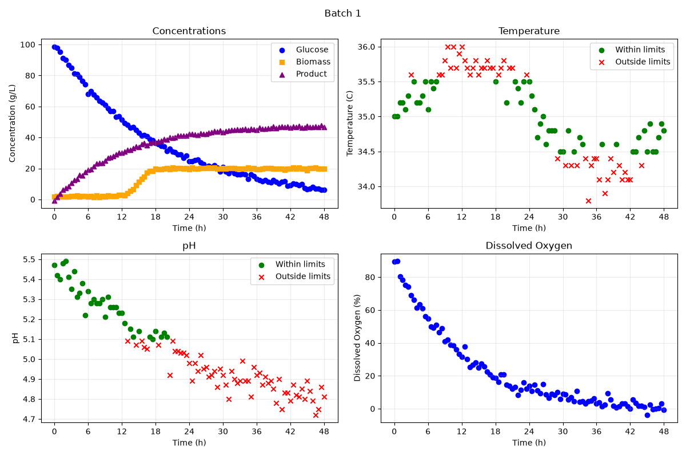

# Fermentation Batch Monitor

A Python program that checks fermentation batch data and creates dashboards and summary tables based on pH and temperature limits.

## Overview

The goal of this project was to make a simple way to monitor fermentation batches using process data.

The program looks at several batches and checks whether the pH and temperature stay within set operating limits. It also creates plots so the batch behaviour can be seen over time, and summary tables to compare the batches.

Two different operating modes are used so the same data can be checked using different pH and temperature limits.

## Features

The `BioprocessMonitor` class can:

- Read the fermentation dataset from a CSV file.
- Pull out the data for one batch at a time.
- Check whether each pH value is inside the allowed range.
- Check whether each temperature value is inside the allowed range.
- Count how many batches are in the dataset.
- Create a dashboard for each batch.
- Calculate the percentage of pH readings that were in range.
- Calculate the percentage of temperature readings that were in range.
- Find the final product concentration for each batch.
- Save summary results to CSV files.

## Technologies Used

- Python 3.14.7
- pandas 3.0.5
- Matplotlib 3.11.0

## Code Design

The program starts from `main.py`.

`main.py` imports the `BioprocessMonitor` class from `src/classes.py` and runs the analysis using two different operating modes.

### Mode A

- pH range: 4.8 to 5.6
- Temperature range: 34.0 to 36.0 °C

### Mode B

- pH range: 5.1 to 5.5
- Temperature range: 34.5 to 35.5 °C

For each mode, a `BioprocessMonitor` object is created using the fermentation dataset and the operating limits.

The program then goes through each batch and creates a dashboard. These figures are saved in the `figures` folder.

After all of the dashboards are created, the program makes a summary table for each mode and saves the results in the `tables` folder.

## Dashboard

Below is the dashboard for Batch 1 using Mode B.

The top-left plot shows glucose, biomass, and product concentration over time.

The top-right plot shows temperature. Green circles mean the temperature was within the Mode B limits, while red X markers mean it was outside the limits.

The bottom-left plot shows pH in the same way, with green points for values in range and red X markers for values outside the range.

The bottom-right plot shows dissolved oxygen over time.

The dashboard makes it easier to see how the batch changes during the process and where the pH or temperature goes outside the chosen operating range.

## Summary Table

The summary table gives one row for each batch.

It shows the percentage of pH and temperature readings that were within the operating limits, as well as the final product concentration.

### Mode A Summary

| batch_id | ph_optimal_percent | temperature_optimal_percent | C_product_g_L^-1_final |
|----------|--------------------|-----------------------------|------------------------|
| 1 | 93.81 | 97.94 | 46.5 |
| 2 | 96.69 | 97.52 | 50.8 |
| 3 | 95.89 | 93.15 | 44.6 |
| 4 | 100.0 | 96.47 | 48.6 |
| 5 | 48.62 | 99.08 | 24.7 |

For Mode A, most of the batches stayed within the pH and temperature limits for most of the run.

Batch 4 had 100% of its pH measurements within range. Batch 5 was different from the others, with only 48.62% of its pH measurements within range, even though 99.08% of its temperature measurements were acceptable.

Batch 2 had the highest final product concentration at 50.8 g/L, while Batch 5 had the lowest at 24.7 g/L.